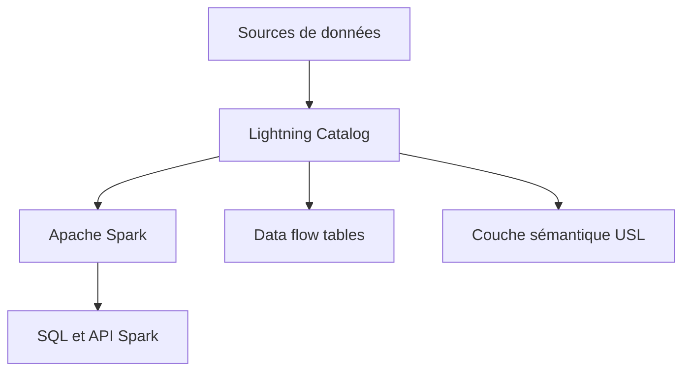

# zetaris/lightning-catalog

> Open-source data catalog on Spark that federates heterogeneous sources accessible through SQL.

## The problem
Enterprise data lives in several systems; connecting them requires copies into a central repository.

## What it actually does
Manages the access points to sources and exposes them through SQL and the Spark API. Allows federated joins without moving the data, "data flow" tables for declarative ETL, ingestion of unstructured files, a semantic layer through DDL and constraint checks (PK, unique, FK).

## How it is wired
Simplified diagram based on the sheet, no diagram provided.


## Trying it
```bash
./gradlew build
./gradlew build -x test -x integrationTest
./gradlew spotlessApply
```

## Cost and gotchas
Free, but you need Spark and a Java version (1.8, 11 or 17 to 19, according to the README). You must copy the JDBC drivers into `3rd-party-lib` and configure `start-light.sh`.

## What it is not
Not a managed catalog nor a SaaS. Last push in February 2026: modest activity, maturity not demonstrated.

## Alternatives
No alternative named in the README.

## For you
Worth watching if you are looking for SQL federation on Spark; too little documented for adoption without a trial.
