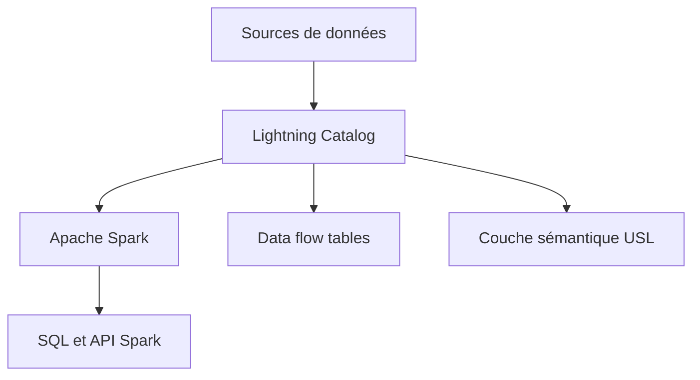

# zetaris/lightning-catalog

> Catalogue de données open source sur Spark, qui fédère des sources hétérogènes accessibles en SQL.

## Le problème
Les données d'entreprise vivent dans plusieurs systèmes ; les relier demande des copies vers un référentiel central.

## Ce que ça fait vraiment
Gère les points d'accès aux sources et les expose en SQL et API Spark. Permet des jointures fédérées sans déplacer les données, des tables « data flow » pour des ETL déclaratifs, l'ingestion de fichiers non structurés, une couche sémantique par DDL et des contrôles de contraintes (PK, unique, FK).

## Comment c'est branché
Schéma simplifié d'après la fiche, sans diagramme fourni.


## Essayer
```bash
./gradlew build
./gradlew build -x test -x integrationTest
./gradlew spotlessApply
```

## Coût et pièges
Gratuit, mais il faut Spark et une version de Java (1.8, 11 ou 17 à 19, selon le README). Il faut copier les pilotes JDBC dans `3rd-party-lib` et régler `start-light.sh`.

## Ce que ce n'est pas
Pas un catalogue managé ni un SaaS. Dernier push en février 2026 : activité modeste, maturité non démontrée.

## Alternatives
Aucune alternative nommée dans le README.

## Pour toi
À surveiller si tu cherches une fédération SQL sur Spark ; trop peu documenté pour une adoption sans essai.

