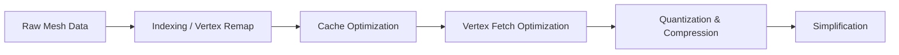

# zeux/meshoptimizer

> C/C++ library for optimizing, compressing and simplifying 3D meshes for GPU rendering.

## The problem
Poorly ordered meshes waste memory bandwidth, vertex caches and pixels computed on the GPU.

## What it actually does
A pipeline of algorithms: indexing, vertex cache, overdraw, vertex fetch, quantization, index filtering. On top of that come vertex and index compression, meshlets for mesh shading, mesh simplification, voxel remeshing (experimental) and analyzers. Companions: gltfpack and clusterlod.h.

## How it is wired


## Trying it
```bash
git clone -b v1.3 https://github.com/zeux/meshoptimizer.git
```
Then include `src/meshoptimizer.h` and the `src/*.cpp` files, or use CMake.

## Cost and gotchas
Free. The order of the steps matters; some APIs are marked experimental and may change.

## What it is not
Not a rendering engine or a general-purpose tool: it prepares geometry data.

## Alternatives
- Google Draco: cited for compression, with a different trade-off (compression ratio versus rendering order).

## For you
Ignore: relevant for 3D rendering and glTF, not for data or AI.
