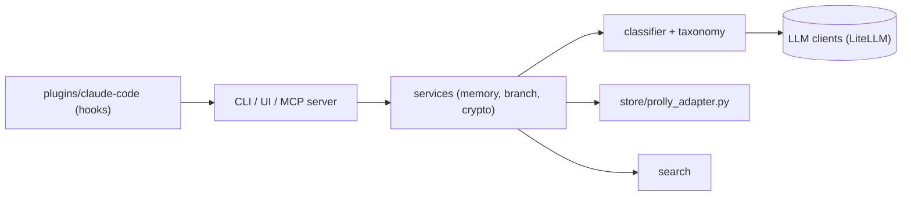

# zhangfengcdt/memoir

> Git-style versioned memory for AI agents, with semantic paths, a CLI, an MCP server and agent plugins.

## The problem
Agent memories (`CLAUDE.md`, vector databases) are blobs with no history: one bad session pollutes everything, and each update invalidates the prefix cache.

## What it actually does
Stores memories at paths like `preferences.coding.style`, with branches, commits, merge and rollback, in a prolly-tree type store. Automatic classification and semantic recall go through an LLM (Haiku 4.5 by default); path reads and keyword recall work without an LLM. Ships with a CLI, a web interface, an MCP server, and plugins for Claude Code, Codex, Hermes and OpenClaw.

## How it is wired


## Trying it
```bash
pip install memoir-ai
memoir new my-memoir-store
cd my-memoir-store
memoir remember "Sarah prefers tabs and 2-space indents" -p preferences.coding.style
memoir get preferences.coding.style
memoir recall "what does Sarah prefer?"
memoir ui
```

## Cost and gotchas
Classification and `recall` call an LLM: an `ANTHROPIC_API_KEY` (or other) at your expense; without a key, it tries `claude -p`. The plugin's hooks automatically capture memories from your sessions.

## What it is not
Not a vector database: path lookups are exact. The performance claims (O(log n)) and cryptographic integrity come from the README, with no measurement provided.

## Alternatives
The README names no specific alternative (it compares with `CLAUDE.md`, `MEMORY.md` and vector databases).

## For you
Watch: an interesting idea of auditable, versioned agent memory, to test on a small store before entrusting data to it.
