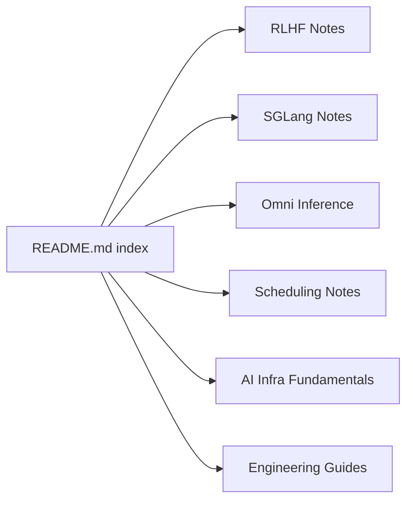

# zhaochenyang20/Awesome-ML-SYS-Tutorial

> Course notes in English and Chinese on RL infrastructure and LLM inference (SGLang, verl, slime).

## The problem
Understanding the systems behind RLHF training and LLM serving requires reading a lot of scattered code and articles.

## What it actually does
A collection of the author's notes, organized as: RL infra (slime, verl, OpenRLHF, AReaL), inference (SGLang, scheduling, KV cache, constrained decoding, omni/TTS models), fundamentals (CUDA Graph, NCCL, distributed PyTorch, quantization) and a Docker guide. Some entries are marked "Pending Review" or "Not finished".

## How it is wired

## Trying it
No documented commands. Read the notes directly from the README index.

## Cost and gotchas
Free. Some of the articles are linked to Zhihu or are in Chinese only ("Available in Chinese version"). The author considers the GitHub rendering of some posts to be poor.

## What it is not
Not a structured tutorial nor executable code: these are personal learning notes, of uneven polish.

## Alternatives
No alternative named in the README.

## For you
Adopt as reading material: free and directly useful to an MLOps profile who needs to understand how SGLang, verl or slime serve and train LLMs, provided you accept uneven notes.
