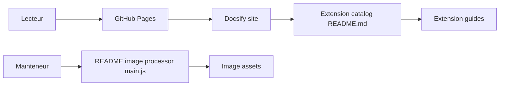

# zhaoolee/ChromeAppHeroes

> Chinese catalog of 133 Chrome extensions, commented one by one, for Chinese-speaking readers.

## The problem
Finding good Chrome extensions and knowing what they are for, in Chinese.

## What it actually does
A README in the form of a numbered table of contents (001 to 133) that links to a written entry per extension: translation, ad blocking, video download, English learning, developer tools. The site is built with docsify and hosted on GitHub Pages. A `main.js` script reprocesses the images referenced in the README. The repository also archives implementations of extensions.

## How it is wired

## Trying it
No documented command.

## Cost and gotchas
Free. The README advertises a paid VPN (GLaDOS), promotes video download and restriction-bypass tools, and several entries target Chinese services: read the installed extensions with caution.

## What it is not
Not an extension: it is an editorial list. The content of each entry does not live in the file read, so it cannot be verified here. GPL-3.0 license: it applies to the text, not to the extensions described.

## Alternatives
- chajian5: extension recommendation site, cited in the README.

## For you
Ignore for a data/AI profile: general-public convenience catalog, in Chinese, unrelated to your tools; the Chrome Web Store is enough.
