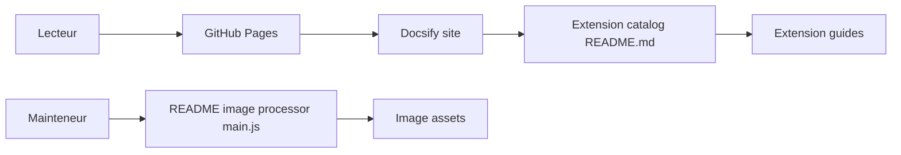

# zhaoolee/ChromeAppHeroes

> Catalogue chinois de 133 extensions Chrome commentées une par une, pour lecteurs sinophones.

## Le problème
Trouver de bonnes extensions Chrome et savoir à quoi elles servent, en chinois.

## Ce que ça fait vraiment
Un README sous forme de sommaire numéroté (001 à 133) qui renvoie à une fiche rédigée par extension : traduction, blocage de pubs, téléchargement vidéo, apprentissage de l'anglais, outils de développeur. Le site est construit avec docsify et hébergé sur GitHub Pages. Un script `main.js` retraite les images référencées dans le README. Le dépôt archive aussi des implémentations d'extensions.

## Comment c'est branché

## Essayer
Aucune commande documentée.

## Coût et pièges
Gratuit. Le README fait de la publicité pour un VPN payant (GLaDOS), fait la promotion d'outils de téléchargement vidéo et de contournement de restrictions, et plusieurs fiches ciblent des services chinois : lis les extensions installées avec prudence.

## Ce que ce n'est pas
Pas une extension : c'est une liste éditoriale. Le contenu de chaque fiche ne vit pas dans le fichier lu, il n'est donc pas vérifiable ici. Licence GPL-3.0 : elle s'applique au texte, pas aux extensions décrites.

## Alternatives
- chajian5 : site de recommandation d'extensions, cité dans le README.

## Pour toi
À ignorer pour un profil data/IA : catalogue de confort grand public, en chinois, sans lien avec tes outils ; le Chrome Web Store suffit.

