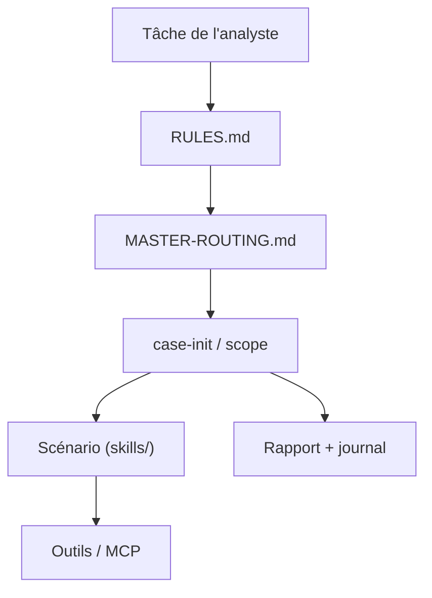

# zhaoxuya520/reverse-skill

> Skill router for AI agents in reverse engineering, CTF and penetration testing.

## The problem
An agent does not know how to choose between jadx, apktool, Frida, IDA or Burp depending on the task, and repeats the same mistakes.

## What it actually does
Routing rules (JSON), triage scripts and initialization of investigation folders with scope, evidence log and report. Modules by scenario: APK, JS, binaries, malware, API, pentest. Also contains a Burp extension with an HTTP server and an stdio MCP bridge.

## How it is wired


## Trying it
```bash
git clone https://github.com/zhaoxuya520/reverse-skill.git
bash skills/scripts/refresh-tool-index.sh
```

## Cost and gotchas
Free; JDK, Node 22.12+, Python and an agent client are required, plus the tools (IDA, Ghidra, Burp) to install. Legal use only (README warning).

## What it is not
Not a turnkey scanner. The README counters diverge (43 or 44 rules, 173 or 175 cases).

## Alternatives
No alternative named in the README.

## For you
Ignore: offensive security is far from your data/MLOps profile, and it is a recent project with a single maintainer.
