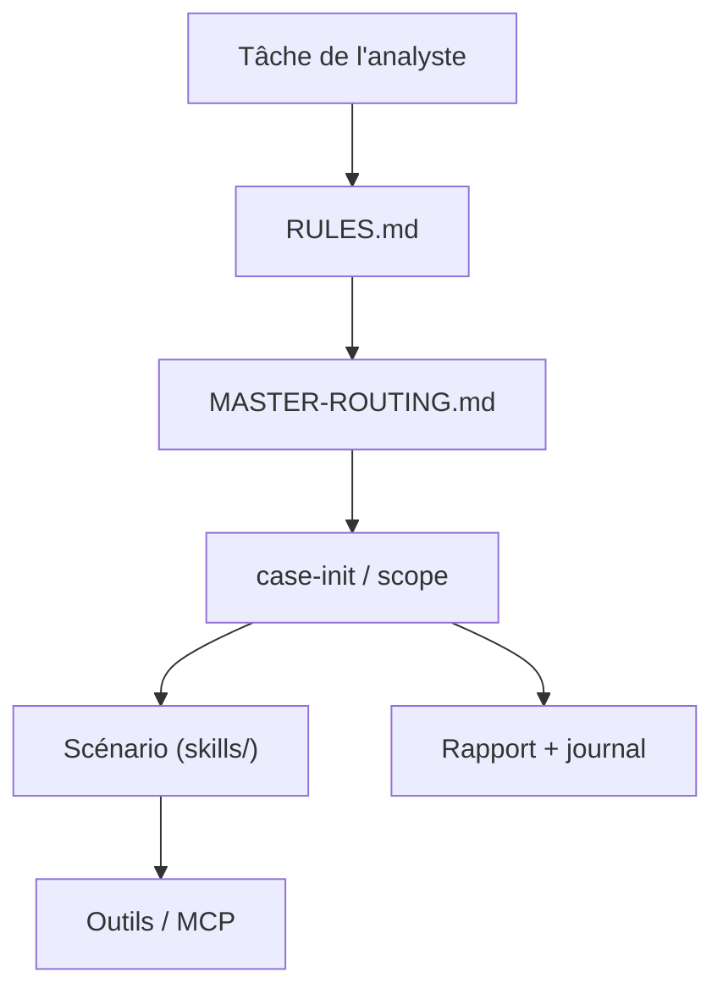

# zhaoxuya520/reverse-skill

> Routeur de compétences pour agents IA en rétro-ingénierie, CTF et tests d'intrusion.

## Le problème
Un agent ne sait pas choisir entre jadx, apktool, Frida, IDA ou Burp selon la tâche, et répète les mêmes erreurs.

## Ce que ça fait vraiment
Règles de routage (JSON), scripts de triage et d'initialisation de dossiers d'enquête avec périmètre, journal de preuves et rapport. Modules par scénario : APK, JS, binaires, malware, API, pentest. Contient aussi une extension Burp avec serveur HTTP et pont MCP stdio.

## Comment c'est branché


## Essayer
```bash
git clone https://github.com/zhaoxuya520/reverse-skill.git
bash skills/scripts/refresh-tool-index.sh
```

## Coût et pièges
Gratuit ; JDK, Node 22.12+, Python et client d'agent requis, plus les outils (IDA, Ghidra, Burp) à installer. Usage légal uniquement (avertissement du README).

## Ce que ce n'est pas
Pas un scanner clé en main. Les compteurs du README divergent (43 ou 44 règles, 173 ou 175 cas).

## Alternatives
Aucune alternative nommée dans le README.

## Pour toi
À ignorer : domaine sécurité offensive éloigné de ton profil data/MLOps, et projet récent à mainteneur unique.

