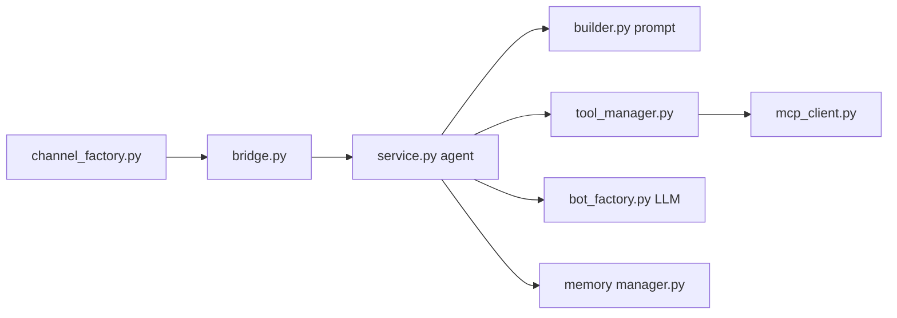

# zhayujie/CowAgent

> Self-hosted assistant agent, connected to messaging platforms and LLMs, for those who want a personalized bot with advanced features.

## The problem
Connecting an LLM to WeChat, Feishu, Telegram, or Slack, requires assembling many different components, including the necessary tools, memory, and expertise.

## What it actually does
Adapters (`channel_factory.py`) normalize messages and pass them to a bridge (`bridge.py`), which launches an agent loop (`agent/chat/service.py`): prompt, model calls, tools (files, bash, browser, scheduler, MCP) and skills are passed to a manifest. A three-level memory system with nightly distillation, a Markdown knowledge base, and a web console on port 9899. Multiple providers are used via `bot_factory.py`. Previous name: `chatgpt-on-wechat`.

## How it is wired


## Trying it
```bash
bash <(curl -fsSL https://cdn.link-ai.tech/code/cow/run.sh)
curl -O https://cdn.link-ai.tech/code/cow/docker-compose.yml
docker compose up -d
cow start | stop | restart
```

## Cost and gotchas
You are responsible for managing the LLM API key; the README warns that the agent mode consumes significantly more tokens than the chat mode. The agent has access to the local OS: it should only be deployed in a trusted environment.

## What it is not
This is not a framework of agents to import into your code; it is a complete service. The installer uses LinkAI's CDN, which also offers a hosted solution.

## Alternatives
- AgentMesh — a multi-agent framework from the same author, with a greater emphasis on libraries.
- bot-on-anything — a lighter framework for connecting an LLM to messaging platforms.

## For you
If you're looking for a personal assistant via messaging, this might be too much space for a specific professional need.
