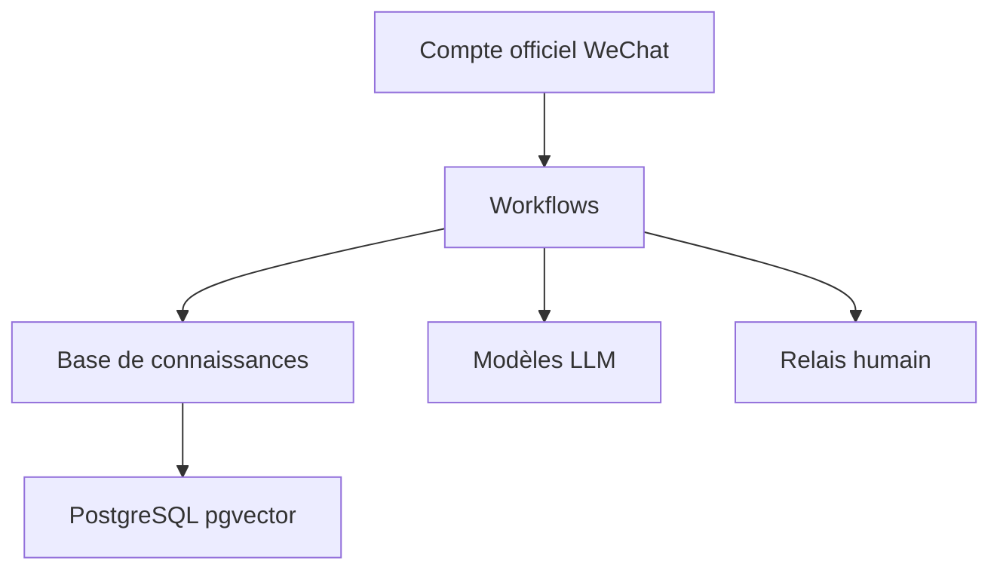

# zhimaAi/chatwiki

> AI workflow platform centered on WeChat official accounts, with a knowledge base and agents.

## The problem
Answering the messages and comments of a WeChat account and publishing articles takes a lot of manual work.

## What it actually does
Drag-and-drop workflows triggered by WeChat messages, subscriptions or menus. Knowledge base (chunking, graph, hybrid search on pgvector), handoff to a human, more than 20 models (DeepSeek, OpenAI, Claude), MCP and an OpenAPI API.

## How it is wired
Simplified diagram based on the sheet, no diagram provided.



## Trying it
```bash
git clone https://github.com/zhimaAi/chatwiki.git
cd chatwiki/docker
docker compose up -d
```

## Cost and gotchas
Docker required, model API keys at your expense. The default password (admin) is in the README: change it.

## What it is not
Not a general-purpose tool: very focused on WeChat. Documentation and contact mostly in Chinese; license not identified.

## Alternatives
No alternative named in the README.

## For you
Worth watching: interesting for the RAG and workflow part, but of no use without the WeChat ecosystem.
