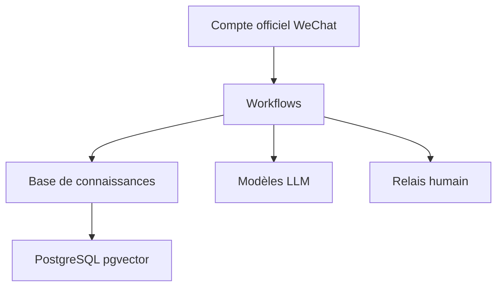

# zhimaAi/chatwiki

> Plateforme de workflows IA centrée sur les comptes officiels WeChat, avec base de connaissances et agents.

## Le problème
Répondre aux messages et commentaires d'un compte WeChat et publier des articles demande beaucoup de travail manuel.

## Ce que ça fait vraiment
Workflows en glisser-déposer déclenchés par messages, abonnements ou menus WeChat. Base de connaissances (segmentation, graphe, recherche hybride sur pgvector), transfert vers un humain, plus de 20 modèles (DeepSeek, OpenAI, Claude), MCP et API OpenAPI.

## Comment c'est branché
Schéma simplifié d'après la fiche, sans diagramme fourni.



## Essayer
```bash
git clone https://github.com/zhimaAi/chatwiki.git
cd chatwiki/docker
docker compose up -d
```

## Coût et pièges
Docker requis, clés d'API de modèles à ta charge. Le mot de passe par défaut (admin) est dans le README : à changer.

## Ce que ce n'est pas
Pas un outil généraliste : très tourné vers WeChat. Documentation et contact surtout en chinois ; licence non identifiée.

## Alternatives
Aucune alternative nommée dans le README.

## Pour toi
À surveiller : intéressant pour la partie RAG et workflows, mais hors utilité sans l'écosystème WeChat.

