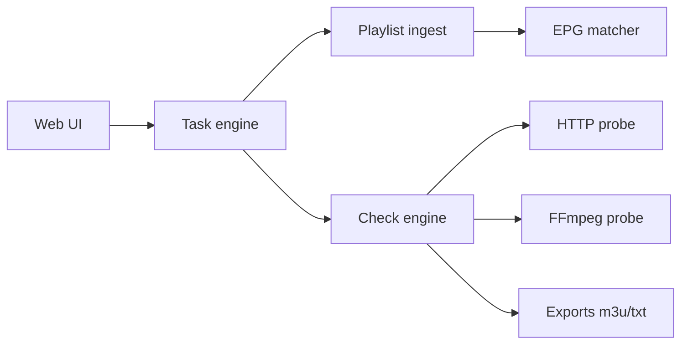

# zhimin-dev/iptv-checker

> Checker for IPTV playlists (M3U, M3U8, TXT) with a web interface, in Docker or as a binary.

## The problem
IPTV lists contain many dead links, hard to filter by hand.

## What it actually does
Tests channels by HTTP request or FFmpeg probe, in scheduled and concurrent tasks, through a web interface (tasks, configuration, export). Exports to M3U or TXT, split into IPv4 / IPv6. Normalizes channel names with EPG data and handles group mapping. An optional GitHub token raises the API call limit (60 to 5000/h). The changelog mentions SSRF hardening.

## How it is wired


## Trying it
```bash
docker pull zmisgod/iptvchecker
docker run -d -p 8081:8089 --name iptv-checker zmisgod/iptvchecker
docker-compose up -d
```

## Cost and gotchas
Free. Interface at http://127.0.0.1:8081. The IPTV sources tested may involve content of dubious licensing: on you.

## What it is not
Not a stream player or a channel provider: it tests lists that you bring.

## Alternatives
None named in the README.

## For you
Ignore: IPTV list cleanup tool, unrelated to data/AI/MLOps.
