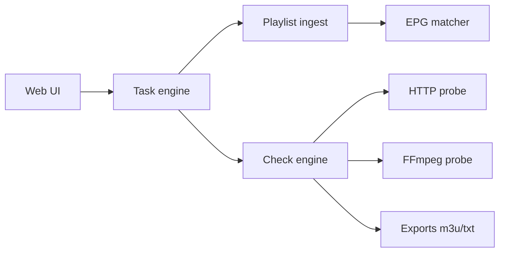

# zhimin-dev/iptv-checker

> Vérificateur de listes de lecture IPTV (M3U, M3U8, TXT) avec interface web, en Docker ou binaire.

## Le problème
Les listes IPTV contiennent beaucoup de liens morts, difficiles à filtrer à la main.

## Ce que ça fait vraiment
Teste les chaînes par requête HTTP ou par sonde FFmpeg, en tâches planifiées et concurrentes, via une interface web (tâches, configuration, export). Exporte en M3U ou TXT, séparé IPv4 / IPv6. Normalise les noms de chaînes avec des données EPG et gère un mappage de groupes. Un jeton GitHub optionnel relève la limite d'appels API (60 à 5000/h). Le changelog cite un durcissement SSRF.

## Comment c'est branché


## Essayer
```bash
docker pull zmisgod/iptvchecker
docker run -d -p 8081:8089 --name iptv-checker zmisgod/iptvchecker
docker-compose up -d
```

## Coût et pièges
Gratuit. Interface sur http://127.0.0.1:8081. Les sources IPTV testées peuvent relever de contenus à licence douteuse : à ta charge.

## Ce que ce n'est pas
Pas un lecteur de flux ni un fournisseur de chaînes : il teste des listes que tu apportes.

## Alternatives
Aucune nommée dans le README.

## Pour toi
Ignorer : outil de nettoyage de listes IPTV, sans lien avec data/IA/MLOps.

