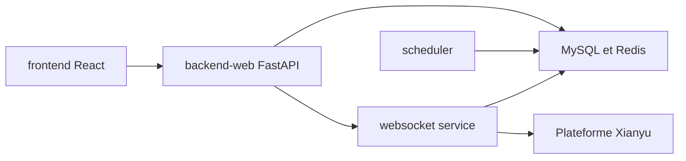

# zhinianboke/xianyu-auto-reply

> Multi-account automation platform for the Chinese marketplace Xianyu: replies, delivery, listing.

## The problem
Xianyu sellers reply, deliver and list by hand; the goal is to automate these flows across several accounts.

## What it actually does
FastAPI, WebSocket and scheduler services: account login (Cookie, QR), automatic replies by keyword or AI, automatic card delivery, listing publication, order tracking, listing monitoring, external APIs via secret key, plus an affiliate subsystem and an Expo mobile client. README in Chinese.

## How it is wired


## Trying it
```bash
git clone https://github.com/zhinianboke/xianyu-auto-reply.git
cd xianyu-auto-reply
bash deploy.sh
```

## Cost and gotchas
Docker, 4 GB of RAM minimum, MySQL, Redis, Chromium (Playwright). Default admin account `admin`/`admin123` must be changed. The README also offers a remote script run via `curl | bash`. Risk of the account being penalized by the platform, acknowledged by the author.

## What it is not
Not free for commercial use despite the AGPL-3.0: the README forbids any commercial use. Behaviors depend on the platform's unofficial API.

## Alternatives
XianYuApis and XianyuAutoAgent, cited as sources of inspiration.

## For you
Ignore: automation of a Chinese marketplace, with a non-commercial clause and ban risk, unrelated to data/AI/MLOps work.
