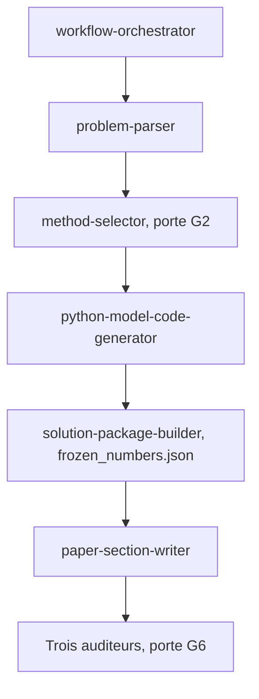

# zhnnky329/MathModeling-skills

> Twenty-eight skills to guide a mathematical modeling contest team, with checkpoints.

## The problem
Teams lose time on method errors: a misread question, an overly complex model with no baseline for comparison, paper figures not produced by a script.

## What it actually does
A plugin for Claude Code and Codex organizes the contest into stages with gates (G1 to G6). It profiles the data, runs a risk test on the method, freezes the figures in `frozen_numbers.json` and launches three independent auditors. The user chooses the method and justifies it; the AI stays in a supporting role.

## How it is wired


## Trying it
```bash
git clone https://github.com/zhnnky329/MathModeling-skills.git
cd MathModeling-skills
./install.sh
./install.sh --target claude
./install.sh --dry-run
```

## Cost and gotchas
Free, apart from the cost of the model used. The README insists: AI usage rules vary between contests, and verification remains your responsibility.

## What it is not
Not a one-click paper generator nor a ghostwriter. It invents no data, results or references.

## Alternatives
No alternative named in the README.

## For you
Worth watching: the idea of frozen figures and on-disk audits can be transposed to your experiment reports, even though the setting is a contest.
