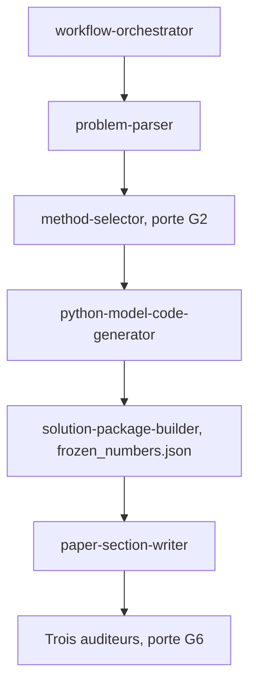

# zhnnky329/MathModeling-skills

> Vingt-huit skills pour guider une équipe de concours de modélisation mathématique, avec des points de contrôle.

## Le problème
Les équipes perdent du temps sur des erreurs de méthode : question mal lue, modèle trop complexe sans base de comparaison, chiffres du papier non produits par un script.

## Ce que ça fait vraiment
Un plugin pour Claude Code et Codex organise le concours en étapes avec des portes (G1 à G6). Il profile les données, fait tourner un test de risque sur la méthode, gèle les chiffres dans `frozen_numbers.json` et lance trois auditeurs indépendants. L'utilisateur choisit la méthode et la justifie ; l'IA reste en appui.

## Comment c'est branché


## Essayer
```bash
git clone https://github.com/zhnnky329/MathModeling-skills.git
cd MathModeling-skills
./install.sh
./install.sh --target claude
./install.sh --dry-run
```

## Coût et pièges
Gratuit, hors coût du modèle utilisé. Le README insiste : les règles d'usage de l'IA varient selon les concours, et la vérification reste à ta charge.

## Ce que ce n'est pas
Pas un générateur d'article en un clic ni un rédacteur fantôme. Il n'invente ni données, ni résultats, ni références.

## Alternatives
Aucune alternative nommée dans le README.

## Pour toi
À surveiller : l'idée de chiffres gelés et d'audits sur disque est transposable à tes rapports d'expériences, même si le cadre est celui d'un concours.

