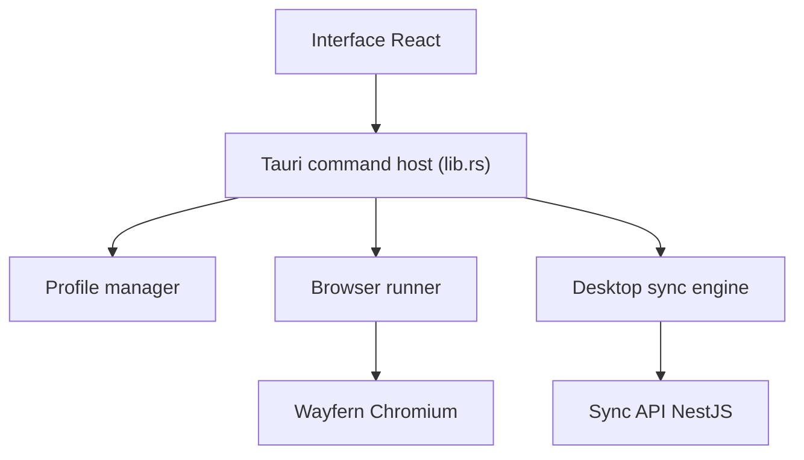

# zhom/donutbrowser

> Anti-detection desktop browser: isolated profiles with their own fingerprint, cookies and proxy.

## The problem
Websites link accounts coming from the same device, and one ban can take them all down.

## What it actually does
A Tauri application: a React interface drives a Rust backend that launches Wayfern, a Chromium fork that sets fingerprints in the engine. Each profile has its own proxy (HTTP, SOCKS) or WireGuard configuration. A local REST API on 127.0.0.1:10108 and an MCP server allow automation through Playwright, Puppeteer or an agent. The README claims zero telemetry and end-to-end encrypted synchronization, self-hostable with a NestJS service.

## How it is wired


## Trying it
```bash
brew install --cask donut
curl -fsSL https://donutbrowser.com/install.sh | sh
nix run github:donutbrowser/donutbrowser#release-start
```

## Cost and gotchas
The application is free; browser automation and the remote MCP fall under the paid plans. The install script pipes curl into sh.

## What it is not
It is not a tool for ordinary online research: it is for managing several identities. The non-detection claims come from the README, with no independent testing.

## Alternatives
No alternative named in the README.

## For you
Keep an eye on it: useful for scraping or multi-account testing, but using anti-detection may violate a site's terms, and automation is paid.
