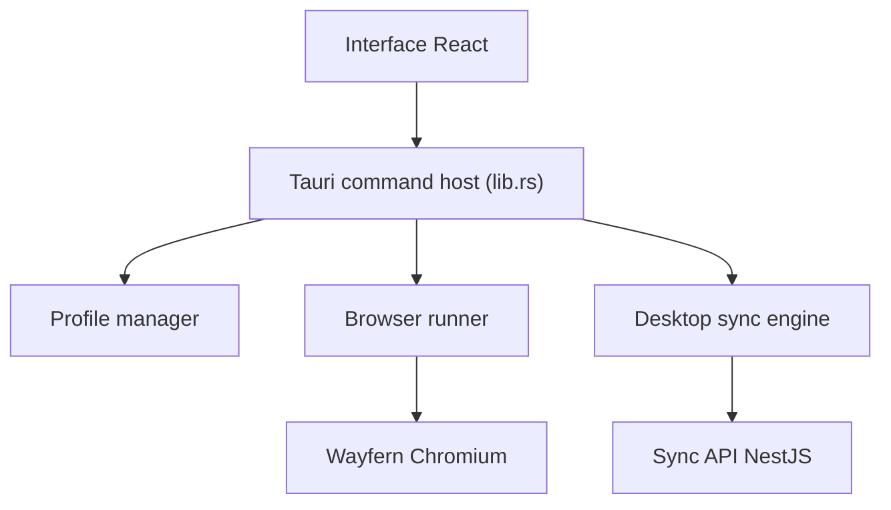

# zhom/donutbrowser

> Navigateur de bureau anti-détection : profils isolés avec empreinte, cookies et proxy propres.

## Le problème
Les sites relient les comptes venant du même appareil, et un bannissement peut tous les emporter.

## Ce que ça fait vraiment
Application Tauri : une interface React pilote un backend Rust qui lance Wayfern, un fork de Chromium qui fixe les empreintes dans le moteur. Chaque profil a son proxy (HTTP, SOCKS) ou sa configuration WireGuard. Une API REST locale sur 127.0.0.1:10108 et un serveur MCP permettent l'automatisation par Playwright, Puppeteer ou un agent. Le README annonce zéro télémétrie et une synchronisation chiffrée de bout en bout, auto-hébergeable avec un service NestJS.

## Comment c'est branché


## Essayer
```bash
brew install --cask donut
curl -fsSL https://donutbrowser.com/install.sh | sh
nix run github:donutbrowser/donutbrowser#release-start
```

## Coût et pièges
L'application est gratuite ; l'automatisation par navigateur et le MCP distant relèvent des offres payantes. Le script d'installation passe par curl vers sh.

## Ce que ce n'est pas
Ce n'est pas un outil pour la recherche en ligne ordinaire : il sert à gérer plusieurs identités. Les affirmations sur la non-détection viennent du README, sans test indépendant.

## Alternatives
Aucune alternative nommée dans le README.

## Pour toi
Surveiller : utile pour du scraping ou des tests multi-comptes, mais l'usage d'anti-détection peut violer les conditions d'un site, et l'automatisation est payante.

