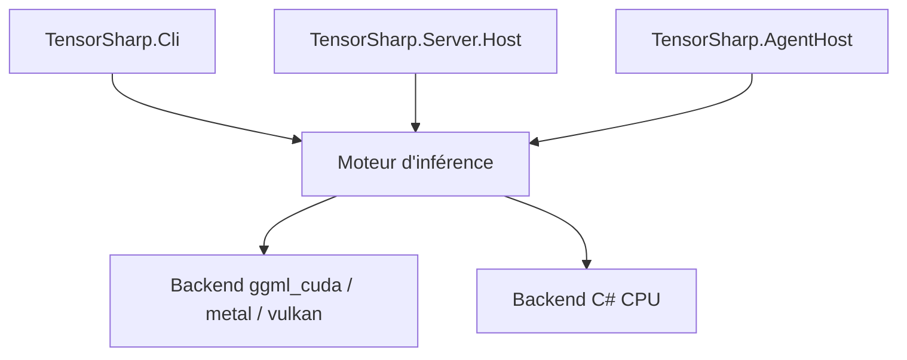

# zhongkaifu/TensorSharp

> .NET 10 engine to run GGUF models locally, with a CLI, web chat and Ollama- and OpenAI-compatible APIs.

## The problem
Running GGUF models from a .NET application forces you to go through llama.cpp or an external service.

## What it actually does
Inference engine with C# kernels on CPU or native CUDA, Metal and Vulkan backends. Paged KV cache, continuous batching, speculative decoding, multi-GPU. Handles text, image, audio, embeddings, image and video generation, agent skills and document collections. TensorAgent app for mobile and desktop.

## How it is wired
Simplified diagram based on the sheet, no diagram provided.



## Trying it
```bash
dotnet run --project TensorSharp.Cli -c Release -p:TensorSharpSkipMlxNative=true -- --model models/gemma-4-E4B-it-Q8_0.gguf --input prompt.txt --max-tokens 128 --backend ggml_cuda
dotnet run --project TensorSharp.Server.Host -c Release -p:TensorSharpSkipMlxNative=true -- --model models/gemma-4-E4B-it-Q8_0.gguf --backend ggml_cuda --max-tokens 512
```

## Cost and gotchas
.NET 10 SDK, CMake, GPU toolchain; 7.48 GiB model; 12 GB of RAM for the app. The server listens on 0.0.0.0:5000 with no authentication or TLS. Speed comparisons are published by the author, on specific cases.

## What it is not
Not a demonstrated replacement for llama.cpp in general: the announced gains apply to specific models and workloads. The source code moves faster than the published packages.

## Alternatives
- llama.cpp: the README's comparison reference.
- Ollama: the exposed API is compatible with its own.

## For you
Watch: useful if you work in .NET with local models, otherwise llama.cpp remains more proven.
