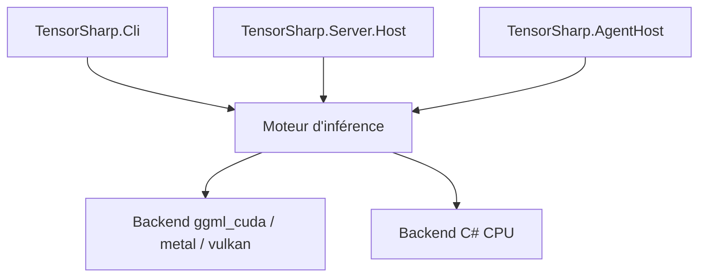

# zhongkaifu/TensorSharp

> Moteur .NET 10 pour exécuter en local des modèles GGUF, avec CLI, chat web et API compatibles Ollama et OpenAI.

## Le problème
Faire tourner des modèles GGUF depuis une application .NET oblige à passer par llama.cpp ou un service externe.

## Ce que ça fait vraiment
Moteur d'inférence avec noyaux C# sur CPU ou backends natifs CUDA, Metal et Vulkan. Cache KV paginé, batching continu, décodage spéculatif, multi-GPU. Gère texte, image, audio, embeddings, génération d'images et de vidéo, skills d'agent et collections de documents. Application TensorAgent pour mobile et bureau.

## Comment c'est branché
Schéma simplifié d'après la fiche, sans diagramme fourni.



## Essayer
```bash
dotnet run --project TensorSharp.Cli -c Release -p:TensorSharpSkipMlxNative=true -- --model models/gemma-4-E4B-it-Q8_0.gguf --input prompt.txt --max-tokens 128 --backend ggml_cuda
dotnet run --project TensorSharp.Server.Host -c Release -p:TensorSharpSkipMlxNative=true -- --model models/gemma-4-E4B-it-Q8_0.gguf --backend ggml_cuda --max-tokens 512
```

## Coût et pièges
SDK .NET 10, CMake, chaîne GPU ; modèle de 7,48 Gio ; 12 Go de RAM pour l'application. Le serveur écoute sur 0.0.0.0:5000 sans authentification ni TLS. Comparaisons de vitesse publiées par l'auteur, sur des cas précis.

## Ce que ce n'est pas
Pas un remplaçant démontré de llama.cpp en général : les gains annoncés valent pour des modèles et charges précis. Le code source avance plus vite que les paquets publiés.

## Alternatives
- llama.cpp : la référence de comparaison du README.
- Ollama : l'API exposée est compatible avec la sienne.

## Pour toi
Surveiller : utile si tu travailles en .NET avec des modèles locaux, sinon llama.cpp reste plus éprouvé.

