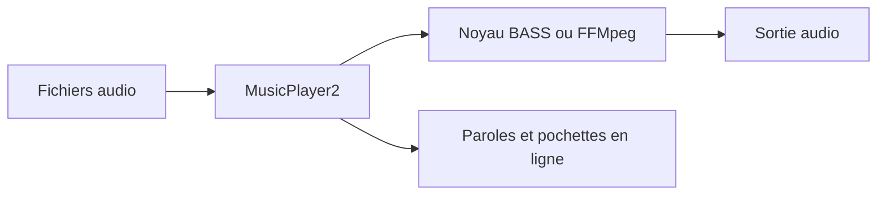

# zhongyang219/MusicPlayer2

> A local music player for Windows, with lyrics and spectrum, for users of audio files.

## The problem
Playing a local library with lyrics, covers and sound settings often requires several programs.

## What it actually does
It plays common audio formats with the BASS and FFMpeg engines. It displays lyrics (karaoke, desktop, taskbar modes), downloads lyrics and covers, edits tags, analyzes the spectrum, offers an equalizer and reverb, format conversion, cue tracks and XML layout. It works on Windows only.

## How it is wired
Simplified diagram based on the fiche, no diagram provided.


## Trying it
```bash
scoop install extras/musicplayer2
```
To build: open `MusicPlayer2.sln` in Visual Studio 2022 with MFC.

## Cost and gotchas
Free. Windows only, Microsoft Visual C++ runtime required. GPL-3.0 license. README in Chinese and English.

## What it is not
Not a cross-platform tool nor a data tool. 567 open issues.

## Alternatives
No alternative named in the README.

## For you
Ignore: a Windows audio player, of no interest for a data, AI or MLOps profile.
