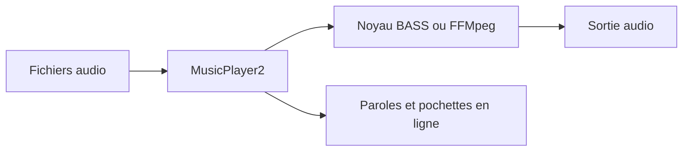

# zhongyang219/MusicPlayer2

> Un lecteur de musique local pour Windows, avec paroles et spectre, pour les utilisateurs de fichiers audio.

## Le problème
Lire une bibliothèque locale avec paroles, pochettes et réglages sonores demande souvent plusieurs logiciels.

## Ce que ça fait vraiment
Il lit les formats audio courants avec les moteurs BASS et FFMpeg. Il affiche les paroles (mode karaoké, bureau, barre des tâches), télécharge paroles et pochettes, édite les tags, analyse le spectre, propose égaliseur et réverbération, conversion de format, pistes cue et disposition XML. Il fonctionne uniquement sous Windows.

## Comment c'est branché
Schéma simplifié d'après la fiche, sans diagramme fourni.


## Essayer
```bash
scoop install extras/musicplayer2
```
Pour compiler : ouvrir `MusicPlayer2.sln` dans Visual Studio 2022 avec MFC.

## Coût et pièges
Gratuit. Windows uniquement, runtime Microsoft Visual C++ requis. Licence GPL-3.0. README en chinois et anglais.

## Ce que ce n'est pas
Pas un outil multiplateforme ni un outil de données. 567 issues ouvertes.

## Alternatives
Aucune alternative nommée dans le README.

## Pour toi
À ignorer : un lecteur audio Windows, sans intérêt pour un profil data, IA ou MLOps.

