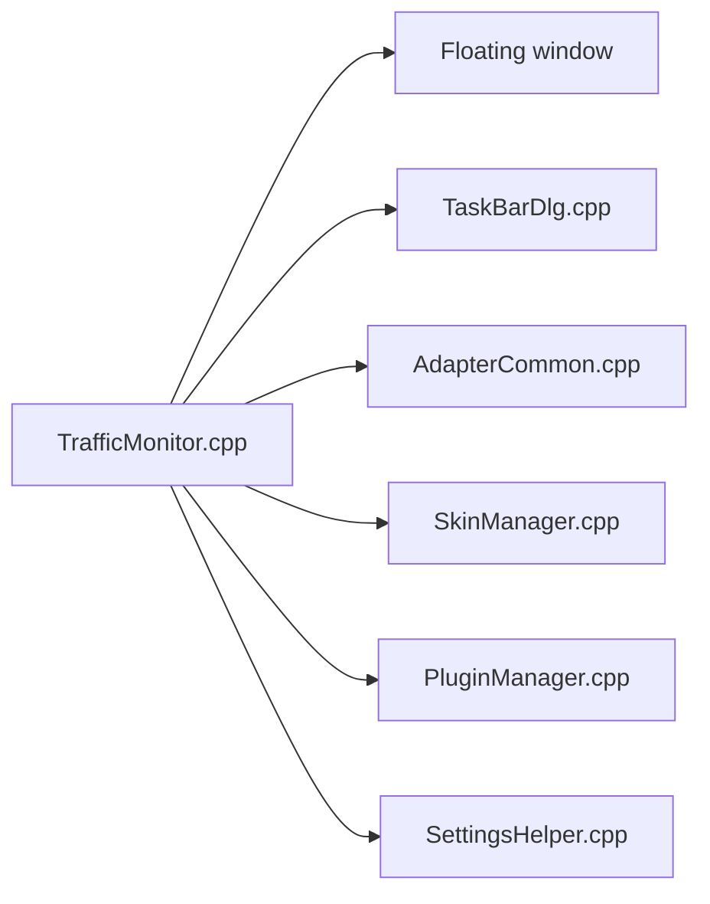

# zhongyang219/TrafficMonitor

> Small floating window for Windows that shows network speed, CPU and memory, embeddable in the taskbar.

## The problem
Windows does not permanently and discreetly display network speed and system load.

## What it actually does
Shows upload/download speed, CPU and memory in a floating window or in the taskbar. Network adapter selection, traffic statistics, skins, plugins. Temperatures have now been moved to a hardware monitoring plugin (LibreHardwareMonitor). README in Chinese and English.

## How it is wired

## Trying it
No command: download the latest release from the GitHub releases, and install the Visual C++ runtime if needed.

## Cost and gotchas
Free. The standard version requires administrator rights; the Lite version does not. The README warns that hardware monitoring can cause crashes or system freezes. The license is not identified by GitHub.

## What it is not
No official website: the domain trafficmonitor.cn is stated to be unrelated to the author. Windows only.

## Alternatives
No alternative named in the README.

## For you
Ignore: a Windows desktop utility unrelated to data/AI, and the license needs clarifying.
