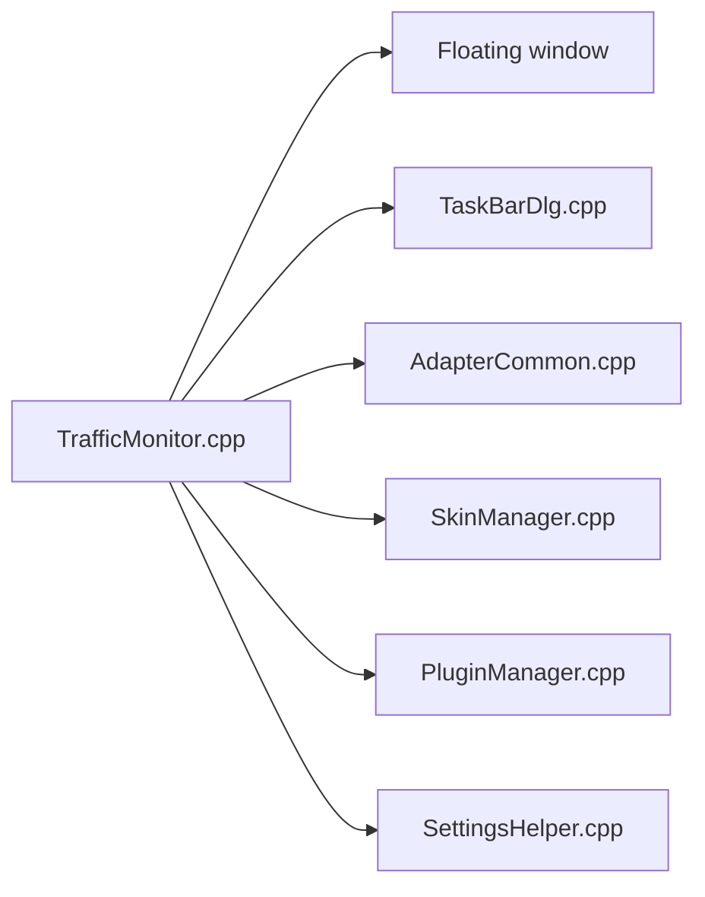

# zhongyang219/TrafficMonitor

> Petite fenêtre flottante pour Windows qui affiche débit réseau, CPU et mémoire, intégrable à la barre des tâches.

## Le problème
Windows n'affiche pas en permanence la vitesse réseau et la charge système de façon discrète.

## Ce que ça fait vraiment
Affiche débit montant/descendant, CPU et mémoire dans une fenêtre flottante ou dans la barre des tâches. Choix de la carte réseau, statistiques de trafic, skins, plugins. Les températures sont désormais déplacées vers un plugin de surveillance matérielle (LibreHardwareMonitor). README en chinois et anglais.

## Comment c'est branché

## Essayer
Aucune commande : télécharger la dernière version depuis les releases GitHub, installer au besoin le runtime Visual C++.

## Coût et pièges
Gratuit. La version standard exige les droits administrateur ; la version Lite non. Le README prévient que la surveillance matérielle peut causer plantages ou gel du système. La licence n'est pas identifiée par GitHub.

## Ce que ce n'est pas
Pas de site officiel : le domaine trafficmonitor.cn est annoncé comme sans lien avec l'auteur. Windows uniquement.

## Alternatives
Aucune alternative nommée dans le README.

## Pour toi
À ignorer : utilitaire de bureau Windows sans rapport avec la data/IA, et licence à clarifier.

