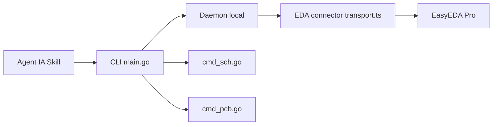

# zhoushoujianwork/easyeda-agent

> AI automation layer for EasyEDA Pro: schematics, PCBs, libraries and checks driven by an agent.

## The problem
Designing schematics and PCBs by hand is slow, and letting an AI write free-form JS in the editor is hard to audit.

## What it actually does
An `easyeda` CLI with a local daemon talks to a connector (.eext) inside EasyEDA Pro through the official `eda.*` API, with typed actions. It creates libraries from a PDF, places and routes components, adjusts silkscreen, replaces components by LCSC number, runs DRC/DFM and exports. It verifies before and after writing. The README is in Chinese.

## How it is wired


## Trying it
```bash
curl -fsSL https://raw.githubusercontent.com/zhoushoujianwork/easyeda-agent/main/install.sh | bash
easyeda daemon start
easyeda health
```

## Cost and gotchas
Requires EasyEDA Pro V4 with "allow external interaction". No programmatic undo; controlled impedance cannot be verified; dense routing requires Freerouting.

## What it is not
Not proof of production readiness: the README states that some cases are not validated. License not identified by GitHub (MIT claimed).

## Alternatives
- Freerouting: for full dense routing.

## For you
Ignore for a data/AI/MLOps profile: an electronics design tool outside your scope.
