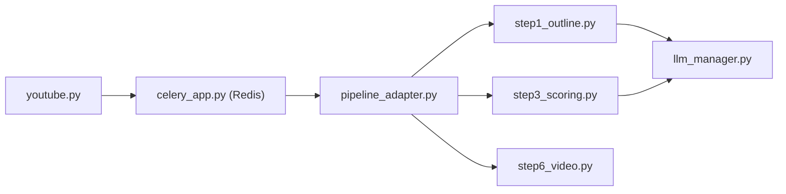

# zhouxiaoka/autoclip

> Application that cuts a long spoken video into short clips chosen by an LLM.

## The problem
Manually spotting the highlights of a podcast, a course or an interview, cutting them, titling them and then publishing them takes hours.

## What it actually does
Imports a YouTube/Bilibili URL or a local file; subtitles are supplied as SRT or transcribed locally by Whisper.
Six-step pipeline: outline, timeline, clip scoring, titles, grouping into collections, video export (FFmpeg); the LLM is involved at every step except the export.
Asynchronous tasks via Celery and Redis; React web interface, desktop app, CLI and MCP server.
Publishing to TikTok, YouTube, etc. through an Upload-Post account, and to Bilibili via cookie.

## How it is wired


## Trying it
```bash
git clone https://github.com/zhouxiaoka/autoclip.git
cd autoclip
cp env.example .env
mkdir -p data logs uploads
docker compose up -d --build
# ou en CLI, après pip install -r requirements.txt && pip install -e . :
autoclip doctor --provider ollama
autoclip run talk.mp4 --provider ollama --json
```

## Cost and gotchas
Cloud model at your expense, or Ollama / LM Studio locally with the hardware that goes with it. Publishing outside China: an Upload-Post account and its quotas. Statistics and error reports depending on the version and settings.

## What it is not
Not a visual editor: the analysis relies on subtitles, so action or music videos yield little.
Not guaranteed: sometimes no clip comes out (lower the threshold from 0.7 to 0.5).
The README promotes a sponsoring API reseller, affiliate link included.

## Alternatives
No alternative named in the README.

## For you
Outside the data/MLOps core: ignore, unless you produce video content.
