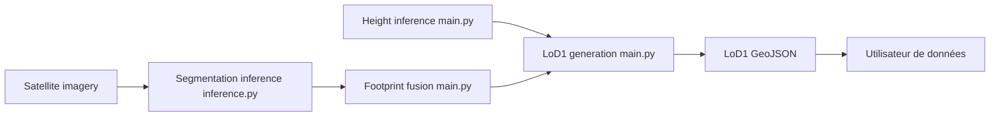

# zhu-xlab/GlobalBuildingAtlas

> Worldwide dataset of building polygons, heights and LoD1 3D models, for geomatics people and researchers.

## The problem
There is no open, worldwide and complete map of buildings with their heights.

## What it actually does
Provides building polygons, machine-learning-estimated heights and LoD1 models. The repository contains the production code: footprint extraction from satellite images, height estimation (HTC-DC Net), polygon fusion and LoD1 generation. The data is on Hugging Face and mediaTUM; a `produce_lod1.py` script rebuilds the LoD1 GeoJSON files.

## How it is wired


## Trying it
```bash
python produce_lod1.py
python produce_lod1.py --odbl_root /path/to/odbl --polygon_root /path/to/polygon --json_root /path/to/json --output_root /path/to/output
```

## Cost and gotchas
Free, but the data is split into three parts because of incompatible licenses: ODbL (OSM, Microsoft) and BY-NC. Downloading means accepting the Terms of Use and the License Notice. The CRS is EPSG:3857, even when a file claims 4326. Do not query the WFS service in bulk.

## What it is not
Not a guaranteed source: heights come from a model, so errors and missing areas are possible. The repository license is present but not identified by GitHub, and part of the data is non-commercial.

## Alternatives
No alternative named in the README.

## For you
Worth watching: a good basis for large-scale urban modeling, but the non-commercial clause and the license to verify rule out business use without review.
