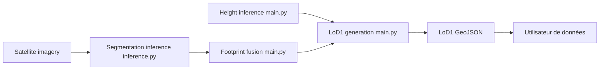

# zhu-xlab/GlobalBuildingAtlas

> Jeu de données mondial de polygones de bâtiments, hauteurs et modèles 3D LoD1, pour géomaticiens et chercheurs.

## Le problème
Il n'existe pas de carte ouverte, mondiale et complète des bâtiments avec leurs hauteurs.

## Ce que ça fait vraiment
Fournit des polygones de bâtiments, des hauteurs estimées par apprentissage automatique et des modèles LoD1. Le dépôt contient le code de production : extraction des empreintes depuis des images satellites, estimation de hauteur (HTC-DC Net), fusion des polygones et génération LoD1. Les données sont sur Hugging Face et mediaTUM ; un script `produce_lod1.py` recompose les GeoJSON LoD1.

## Comment c'est branché


## Essayer
```bash
python produce_lod1.py
python produce_lod1.py --odbl_root /path/to/odbl --polygon_root /path/to/polygon --json_root /path/to/json --output_root /path/to/output
```

## Coût et pièges
Gratuit, mais les données sont scindées en trois parties à cause de licences incompatibles : ODbL (OSM, Microsoft) et BY-NC. Télécharger, c'est accepter les Terms of Use et le License Notice. Le CRS est EPSG:3857, même quand un fichier annonce 4326. Ne pas interroger le service WFS en masse.

## Ce que ce n'est pas
Pas une source garantie : les hauteurs sont issues d'un modèle, des erreurs et des zones manquantes sont possibles. La licence du dépôt est présente mais non identifiée par GitHub, et une partie des données est non commerciale.

## Alternatives
Aucune alternative nommée dans le README.

## Pour toi
À surveiller : bonne base pour de la modélisation urbaine à grande échelle, mais la clause non commerciale et la licence à vérifier ferment l'usage en entreprise sans examen.

