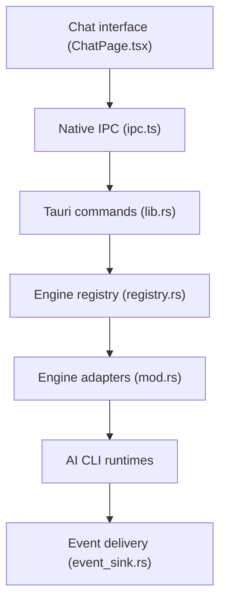

# zhukunpenglinyutong/desktop-cc-gui

> Desktop client that brings together eleven AI coding CLIs (Claude Code, Codex, Kimi...) in a single interface.

## The problem
Each command-line coding agent has its own console: history, models and permissions are managed separately in black terminals.

## What it actually does
Tauri 2 + React + Rust application, for macOS, Windows and Linux. It drives the installed CLIs through adapters, displays streams, reasoning and tool calls, manages session history and adds a file tree, a terminal, a Git panel and a plugin SDK. Provider channels are written into each CLI's native config.

## How it is wired
Diagram based on the one provided.



## Trying it
```bash
git clone https://github.com/zhukunpenglinyutong/desktop-cc-gui.git
cd desktop-cc-gui
pnpm install
pnpm dev
```

## Cost and gotchas
The application is free but requires the CLIs to be installed, along with their keys or subscriptions. The first Rust build takes a few minutes (Node 22.13 and Rust required). Several engines have partial support.

## What it is not
Not an agent: it does not code by itself. The multi-agent team mode is not supported. Documentation and conventions are largely in Chinese.

## Alternatives
No alternative named in the README (CC Switch is cited for channel import).

## For you
Worth watching: handy if you juggle several AI coding CLIs, but the project depends on one person and is still young.
