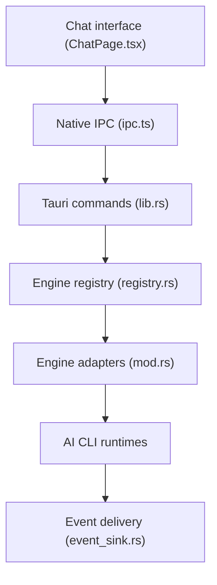

# zhukunpenglinyutong/desktop-cc-gui

> Client de bureau qui regroupe onze CLI de codage IA (Claude Code, Codex, Kimi...) dans une seule interface.

## Le problème
Chaque agent de codage en ligne de commande a sa propre console : historique, modèles et permissions se gèrent séparément dans des terminaux noirs.

## Ce que ça fait vraiment
Application Tauri 2 + React + Rust, pour macOS, Windows et Linux. Elle pilote les CLI installées via des adaptateurs, affiche flux, raisonnements et appels d'outils, gère l'historique des sessions et ajoute arborescence de fichiers, terminal, panneau Git et un SDK de plugins. Les canaux de fournisseurs s'écrivent dans la config native de chaque CLI.

## Comment c'est branché
Schéma d'après le diagramme fourni.



## Essayer
```bash
git clone https://github.com/zhukunpenglinyutong/desktop-cc-gui.git
cd desktop-cc-gui
pnpm install
pnpm dev
```

## Coût et pièges
L'application est gratuite mais exige les CLI installées et leurs clés ou abonnements. La première compilation Rust prend quelques minutes (Node 22.13 et Rust requis). Plusieurs moteurs sont en support partiel.

## Ce que ce n'est pas
Pas un agent : il ne code pas lui-même. Le mode équipe multi-agents n'est pas pris en charge. Documentation et conventions en grande partie en chinois.

## Alternatives
Aucune alternative nommée dans le README (CC Switch est cité pour l'import de canaux).

## Pour toi
À surveiller : pratique si tu jongles entre plusieurs CLI de codage IA, mais le projet dépend d'une personne et reste jeune.

