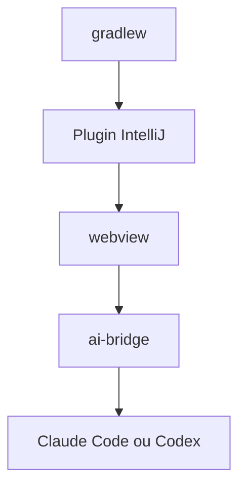

# zhukunpenglinyutong/idea-claude-code-gui

> IntelliJ IDEA plugin offering a visual interface for Claude Code, Codex and other coding CLIs.

## The problem
AI coding CLIs have no native interface in JetBrains IDEs.

## What it actually does
A chat panel in IntelliJ: `@file` references, images, rewinding the conversation, code diff, agents, slash commands, MCP servers, session history and usage statistics. The repository contains a webview (npm) and an `ai-bridge` (npm), built with Gradle.

## How it is wired

Diagram not provided: simplified diagram based on the README.

## Trying it
```bash
cd webview && npm install
cd ../ai-bridge && npm install
./gradlew clean runIde
./gradlew clean buildPlugin
```

## Cost and gotchas
The plugin depends on the installed CLIs and their subscriptions or keys. Built package of about 40 MB.

## What it is not
Not an agent of its own: it is an interface around existing CLIs. The project was renamed to limit trademark risk.

## Alternatives
No alternative named in the README.

## For you
Worth watching if you work in IntelliJ: useful, but 534 open issues and a single person at the helm.
