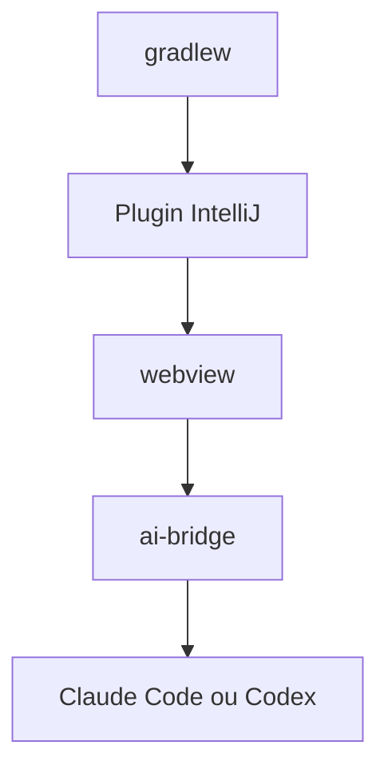

# zhukunpenglinyutong/idea-claude-code-gui

> Plugin IntelliJ IDEA offrant une interface visuelle pour Claude Code, Codex et d'autres CLI de codage.

## Le problème
Les CLI de codage IA n'ont pas d'interface native dans les IDE JetBrains.

## Ce que ça fait vraiment
Un panneau de conversation dans IntelliJ : références `@file`, images, retour en arrière dans la conversation, diff de code, agents, commandes slash, serveurs MCP, historique de sessions et statistiques d'usage. Le dépôt contient un webview (npm) et un `ai-bridge` (npm), construits avec Gradle.

## Comment c'est branché

Schéma non fourni : diagramme simplifié d'après le README.

## Essayer
```bash
cd webview && npm install
cd ../ai-bridge && npm install
./gradlew clean runIde
./gradlew clean buildPlugin
```

## Coût et pièges
Le plugin dépend des CLI installées et de leurs abonnements ou clés. Paquet construit d'environ 40 Mo.

## Ce que ce n'est pas
Pas un agent propre : c'est une interface autour de CLI existantes. Le projet a été renommé pour limiter le risque de marque.

## Alternatives
Aucune alternative nommée dans le README.

## Pour toi
À surveiller si tu travailles sous IntelliJ : utile, mais 534 issues ouvertes et une seule personne à la barre.

