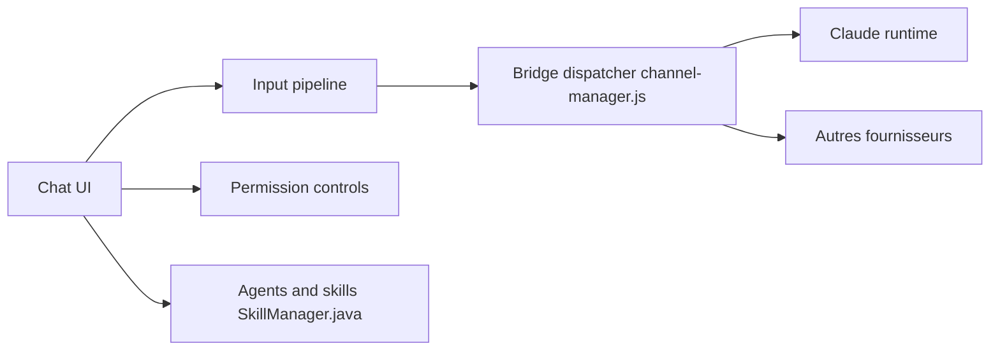

# zhukunpenglinyutong/jetbrains-cc-gui

> IntelliJ plugin with a chat interface for Claude Code, Codex and other coding CLIs.

## The problem
Using a coding agent in the CLI forces you to leave the IDE to follow diffs, history and permissions.

## What it actually does
Chat panel in JetBrains IDEs: `@file` references, images, rewinding the conversation, diff comparison, permission management, slash commands, MCP servers, history and favorites, usage statistics, cc-switch-compatible provider management. An `ai-bridge` relays to the chosen CLI.

## How it is wired


## Trying it
```bash
cd webview && npm install
cd ai-bridge && npm install
./gradlew clean runIde
./gradlew clean buildPlugin
```

## Cost and gotchas
Requires your own CLI access or API keys. Slow scrolling on macOS: JVM option `-Dide.browser.jcef.gpu.disable=true`. Package of about 40 MB. 532 open issues.

## What it is not
Not an agent of its own: an interface around third-party CLIs. The README does not detail installation from the marketplace (link only). Project renamed to limit a trademark risk.

## Alternatives
None named in the README.

## For you
Worth watching: handy if you work in PyCharm or IntelliJ, but a high volume of issues and a single maintainer.
