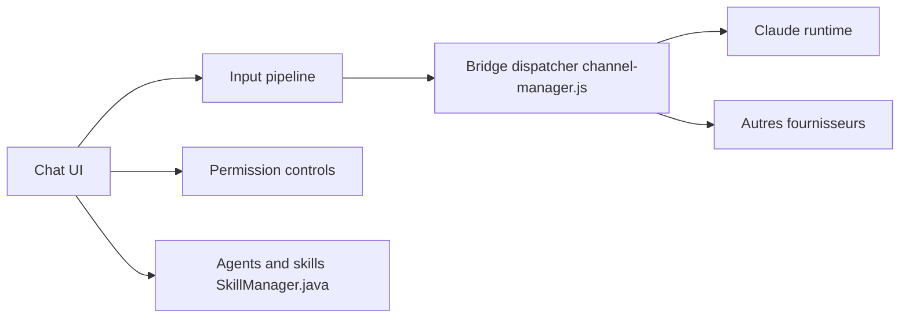

# zhukunpenglinyutong/jetbrains-cc-gui

> Plugin IntelliJ avec interface de chat pour Claude Code, Codex et d'autres CLI de codage.

## Le problème
Utiliser un agent de codage en CLI oblige à quitter l'IDE pour suivre les diffs, l'historique et les permissions.

## Ce que ça fait vraiment
Panneau de chat dans les IDE JetBrains : références `@fichier`, images, retour en arrière dans la conversation, comparaison de diffs, gestion des permissions, commandes slash, serveurs MCP, historique et favoris, statistiques d'usage, gestion de fournisseurs compatible cc-switch. Un pont `ai-bridge` relaie vers le CLI choisi.

## Comment c'est branché


## Essayer
```bash
cd webview && npm install
cd ai-bridge && npm install
./gradlew clean runIde
./gradlew clean buildPlugin
```

## Coût et pièges
Requiert tes propres accès aux CLI ou clés d'API. Défilement lent sur macOS : option JVM `-Dide.browser.jcef.gpu.disable=true`. Paquet d'environ 40 Mo. 532 issues ouvertes.

## Ce que ce n'est pas
Pas un agent propre : une interface autour de CLI tiers. Le README ne détaille pas l'installation depuis le marketplace (lien seul). Projet renommé pour limiter un risque de marque.

## Alternatives
Aucune nommée dans le README.

## Pour toi
À surveiller : pratique si tu travailles dans PyCharm ou IntelliJ, mais fort volume d'issues et mainteneur unique.

