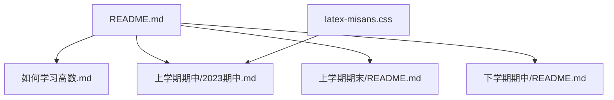

# zhuozhiyongde/Advanced-Mathematics-B-2022-PKU

> Personal past exams and solutions for Peking University's Advanced Mathematics B course, with study tips.

## The problem
First-year students lack solved exam papers and study method for the course.

## What it actually does
A Chinese-language collection of midterm and final exam papers (B1 and B2), personal solutions, a summary of errors in the official solutions and a text on study experience. Rendered as Markdown with a CSS theme. No code.

## How it is wired

## Trying it
No documented command: documents to read in the repository.

## Cost and gotchas
Written in Chinese. The official exam papers and solutions belong to Peking University. The rest is announced as CC BY-NC-SA 4.0 while the catalog lists GPL-3.0.

## What it is not
Not a complete course. The personal solutions may contain errors, as the author says.

## Alternatives
No alternative named in the README.

## For you
Ignore: study material specific to a Peking course, unrelated to data/AI/MLOps.
