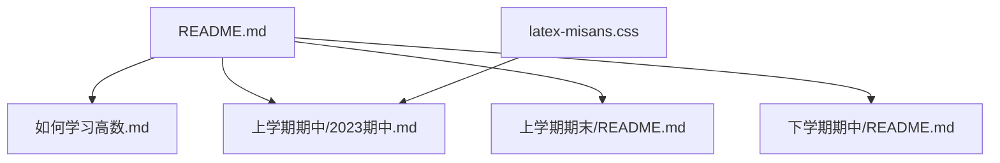

# zhuozhiyongde/Advanced-Mathematics-B-2022-PKU

> Annales et corrigés personnels du cours Mathématiques supérieures B de l'Université de Pékin, avec conseils.

## Le problème
Les étudiants de première année manquent de sujets d'examen corrigés et de méthode pour le cours.

## Ce que ça fait vraiment
Recueil en chinois de sujets de mi-parcours et de fin de semestre (B1 et B2), de corrigés personnels, d'un récapitulatif des erreurs des corrigés officiels et d'un texte d'expérience d'étude. Rendu Markdown avec un thème CSS. Aucun code.

## Comment c'est branché

## Essayer
Aucune commande documentée : documents à lire dans le dépôt.

## Coût et pièges
Rédigé en chinois. Les sujets et corrigés officiels appartiennent à l'Université de Pékin. Le reste est annoncé CC BY-NC-SA 4.0 alors que le catalogue indique GPL-3.0.

## Ce que ce n'est pas
Pas un cours complet. Les corrigés personnels peuvent contenir des erreurs, l'auteur le dit.

## Alternatives
Aucune alternative nommée dans le README.

## Pour toi
Ignorer : support d'étude propre à un cours de Pékin, sans lien avec data/IA/MLOps.

