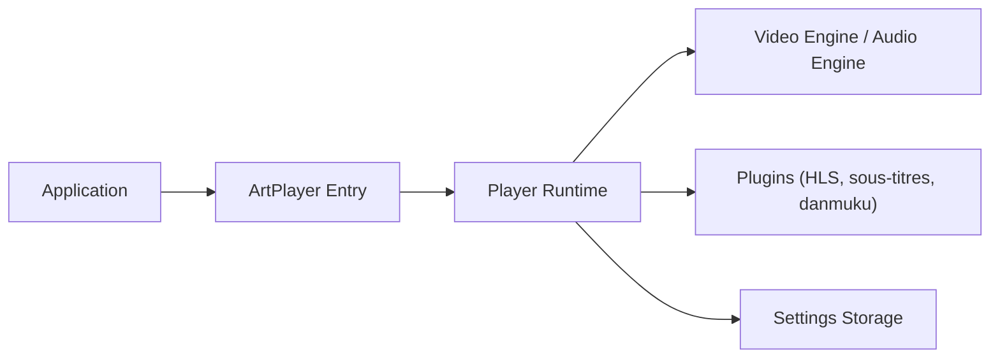

# zhw2590582/ArtPlayer

> Customizable HTML5 video player, with plugins, for web developers.

## The problem
The browser's native player covers neither advanced subtitles, nor HLS/DASH streams, nor floating comments.

## What it actually does
`new Artplayer({ container, url })` creates the player. `.vtt`, `.ass`, `.srt` formats supported; hls.js, dash.js, flv.js, mpegts.js, webtorrent as external libraries; plugins (danmuku, chromecast, VAST, chapters, ASR, etc.). A Mediabunny/Canvas proxy is available.

## How it is wired


## Trying it
```bash
npm install artplayer
```
```js
let art = new Artplayer({
  container: '.artplayer-app',
  url: 'path/to/video.mp4',
})
```

## Cost and gotchas
Free; Patreon/PayPal donations. The advertising plugin is marked WIP.

## What it is not
Not a server or a streaming service: only the client-side player.

## Alternatives
- hls.js, dash.js, flv.js: embeddable playback engines, cited in the README.

## For you
Ignore: a front-end component unrelated to data/AI/MLOps work, except for an occasional need for a web video player.
