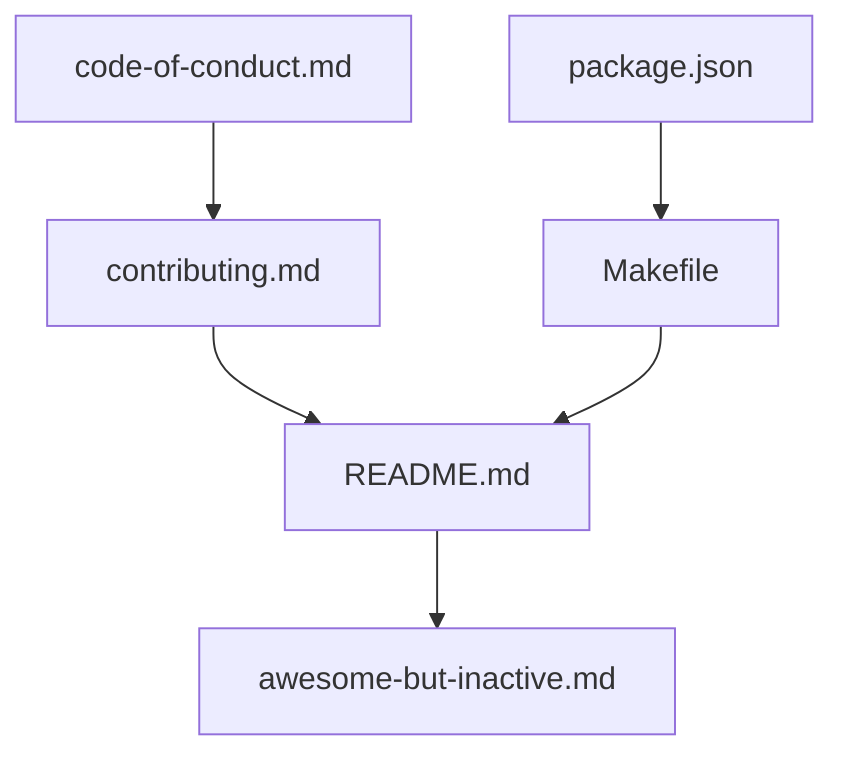

# zigcc/awesome-zig

> Community list of resources, libraries and tools written in Zig or for Zig.

## The problem
Zig packages are scattered and the language evolves fast: hard to know what exists and what still tracks the compiler.

## What it actually does
A README sorts hundreds of links by category: learning, editors, linters, version managers, allocators, parsers, networking, embedded, operating systems, machine learning, graphics. A second file keeps abandoned projects. A warning reminds that some projects require a specific compiler version.

## How it is wired

## Trying it
No command documented: you read the README and follow the links.

## Cost and gotchas
Free, nothing to install. Many entries depend on a moving Zig version: check compatibility in each repository.

## What it is not
Not a tested catalog: entries are not validated one by one. Not a tutorial either, except for the learning section.

## Alternatives
No alternative named in the README.

## For you
Ignore: Zig is outside your daily data/AI work, unless you write low-level extensions; the machine learning and large language model sections remain thin.
