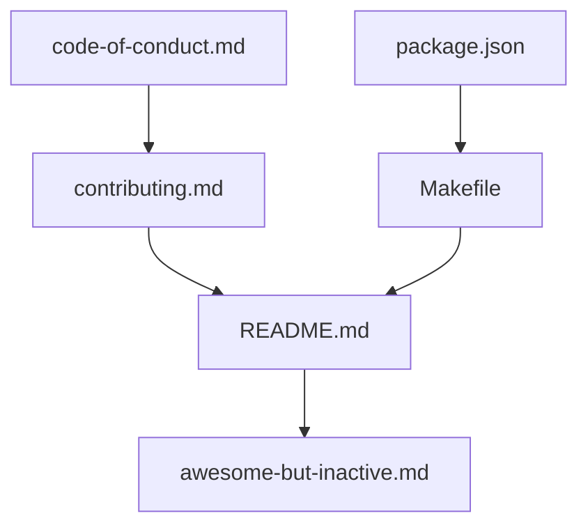

# zigcc/awesome-zig

> Liste communautaire de ressources, bibliothèques et outils écrits en Zig ou pour Zig.

## Le problème
Les paquets Zig sont dispersés et le langage évolue vite : difficile de savoir ce qui existe et ce qui suit encore le compilateur.

## Ce que ça fait vraiment
Un README classe des centaines de liens par catégories : apprentissage, éditeurs, linters, gestionnaires de versions, allocateurs, parseurs, réseau, embarqué, systèmes d'exploitation, apprentissage automatique, graphisme. Un second fichier garde les projets abandonnés. Un avertissement rappelle que certains projets exigent une version précise du compilateur.

## Comment c'est branché

## Essayer
Aucune commande documentée : on lit le README et on suit les liens.

## Coût et pièges
Gratuit, rien à installer. Beaucoup d'entrées dépendent d'une version de Zig qui bouge : vérifier la compatibilité dans chaque dépôt.

## Ce que ce n'est pas
Pas un catalogue testé : les entrées ne sont pas validées une à une. Pas un tutoriel non plus, sauf la section d'apprentissage.

## Alternatives
Aucune alternative nommée dans le README.

## Pour toi
À ignorer : Zig est hors de ton quotidien data/IA, sauf si tu écris des extensions bas niveau ; les sections apprentissage automatique et grand modèle de langage y restent minces.

