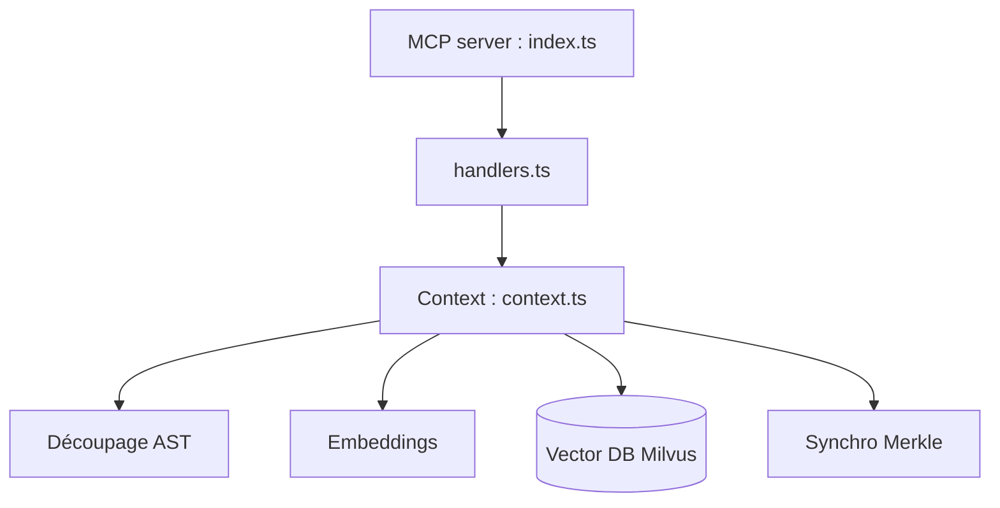

# zilliztech/claude-context

> MCP server that adds semantic code search to Claude Code and other agents.

## The problem
Loading entire directories into the agent's context is expensive and drowns the useful information.

## What it actually does
It indexes the repository in a vector database (Milvus/Zilliz Cloud): syntax-tree chunking, embeddings (OpenAI, VoyageAI, Ollama, Gemini), hybrid BM25 plus vector search, incremental re-indexing via Merkle trees. Four MCP tools: index, search, clear, status. The README claims about 40% fewer tokens.

## How it is wired


## Trying it
```bash
claude mcp add claude-context \
  -e OPENAI_API_KEY=sk-your-openai-api-key \
  -e MILVUS_ADDRESS=your-zilliz-cloud-public-endpoint \
  -e MILVUS_TOKEN=your-zilliz-cloud-api-key \
  -- npx @zilliz/claude-context-mcp@latest
```

## Cost and gotchas
An OpenAI key for embeddings and a Zilliz Cloud account for the vector database: two services on you. Node 20 or later.

## What it is not
Not a local tool by default: deployment without the cloud is deferred to the FAQ. The 40% figure comes from the authors' own evaluation.

## Alternatives
No alternative cited in the README.

## For you
Adopt for a trial: it addresses a real context cost on large repositories, with a stack (embeddings, vector database, MCP) that speaks to you.
