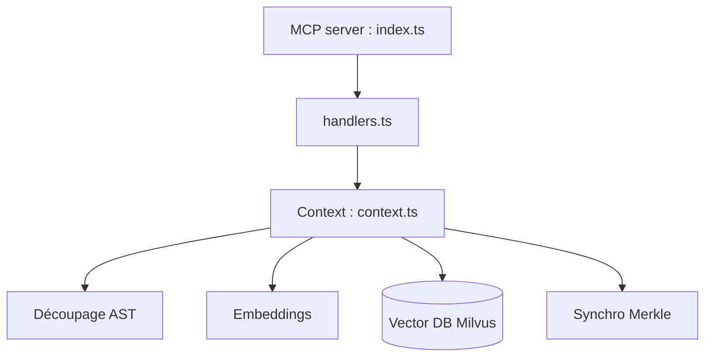

# zilliztech/claude-context

> Serveur MCP qui ajoute la recherche sémantique de code à Claude Code et aux autres agents.

## Le problème
Charger des répertoires entiers dans le contexte de l'agent coûte cher et noie l'information utile.

## Ce que ça fait vraiment
Il indexe le dépôt dans une base vectorielle (Milvus/Zilliz Cloud) : découpage par arbre syntaxique, embeddings (OpenAI, VoyageAI, Ollama, Gemini), recherche hybride BM25 plus vecteurs, ré-indexation incrémentale par arbres de Merkle. Quatre outils MCP : index, recherche, effacement, statut. Le README annonce environ 40 % de jetons en moins.

## Comment c'est branché


## Essayer
```bash
claude mcp add claude-context \
  -e OPENAI_API_KEY=sk-your-openai-api-key \
  -e MILVUS_ADDRESS=your-zilliz-cloud-public-endpoint \
  -e MILVUS_TOKEN=your-zilliz-cloud-api-key \
  -- npx @zilliz/claude-context-mcp@latest
```

## Coût et pièges
Clé OpenAI pour les embeddings et compte Zilliz Cloud pour la base vectorielle : deux services à ta charge. Node 20 ou plus.

## Ce que ce n'est pas
Pas un outil local par défaut : le déploiement sans cloud est renvoyé à la FAQ. Le chiffre de 40 % vient de l'évaluation des auteurs.

## Alternatives
Aucune alternative citée dans le README.

## Pour toi
À adopter pour essai : il répond à un vrai coût de contexte sur gros dépôts, avec une pile (embeddings, base vectorielle, MCP) qui te parle.

