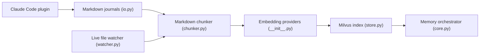

# zilliztech/memsearch

> Semantic memory shared across coding agents, with Markdown notes and Milvus hybrid search.

## The problem
Coding agents forget from one session to the next, and each platform keeps its memory in its own corner.

## What it actually does
Plugins (Claude Code, Codex, DeepSeek Harness, OpenClaw, OpenCode) capture each turn, summarize it and append it to daily Markdown journals. The CLI indexes these files in Milvus (dense search + BM25 + RRF, SHA-256 hash to avoid reindexing), with three-layer recall (search, expansion, transcript). Markdown remains the source of truth; Milvus is a rebuildable index. Options: `PROJECT.md`/`USER.md` and skills drawn from the history, disabled by default.

## How it is wired


## Trying it
```bash
/plugin marketplace add zilliztech/memsearch
/plugin install memsearch
uv tool install "memsearch[onnx]"
memsearch search "Redis caching"
```

## Cost and gotchas
By default: local ONNX bge-m3 embeddings (a model of about 558 MB is downloaded) and Milvus Lite, no key needed. The capture summary calls an LLM; Zilliz Cloud and OpenAI are optional.

## What it is not
Not a simple wrapper: it requires Milvus and an embedding model. 254 open issues.

## Alternatives
No alternative named in the README (OpenClaw is cited as an inspiration).

## For you
Worth watching: sound approach (Markdown as source of truth, everything can run locally), relevant for agent memory on the MLOps side.
