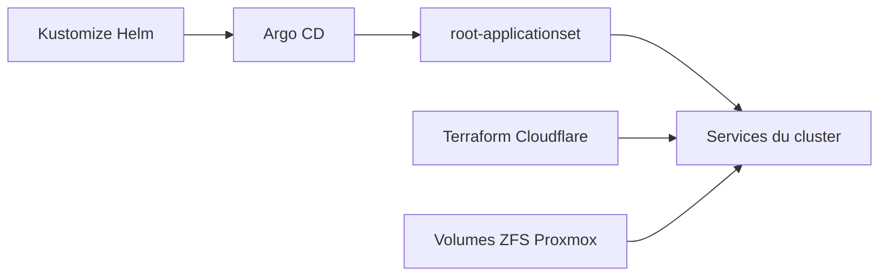

# zimmertr/Kubernetes-Manifests

> Personal Kubernetes manifests for a Proxmox homelab, deployed with Argo CD and Kustomize.

## The problem
A personal cluster needs the same services, secrets and volumes to be found again at every rebuild.

## What it actually does
A repository of services deployed with Argo CD (app-of-apps pattern) on a TKS cluster: Proxmox CCM, MetalLB and Istio or Cilium, a Cloudflare tunnel via Terraform. It also contains llama-swap, Open WebUI, LiteLLM, Jellyfin, Prometheus and Grafana. Secrets and ZFS volumes are created by hand.

## How it is wired
Simplified diagram based on the sheet, no diagram provided.



## Trying it
```bash
kustomize build --enable-helm argo/argo-cd | kubectl apply -f- --server-side --force-conflicts
kubectl apply -f root-appproject.yml
kubectl apply -f root-applicationset.yml
```

## Cost and gotchas
Assumes a TKS cluster on Proxmox, hard-coded ZFS volume names, Cloudflare and a Hevy Pro subscription for one service. Many secrets must be created by hand.

## What it is not
Not a product: it is one person's configuration, not meant to be reused as is. No documentation of the choices.

## Alternatives
No alternative named in the README.

## For you
Watch: a good example to read for serving LLMs (llama-swap, LiteLLM, Open WebUI) on Kubernetes, to adapt rather than deploy.
