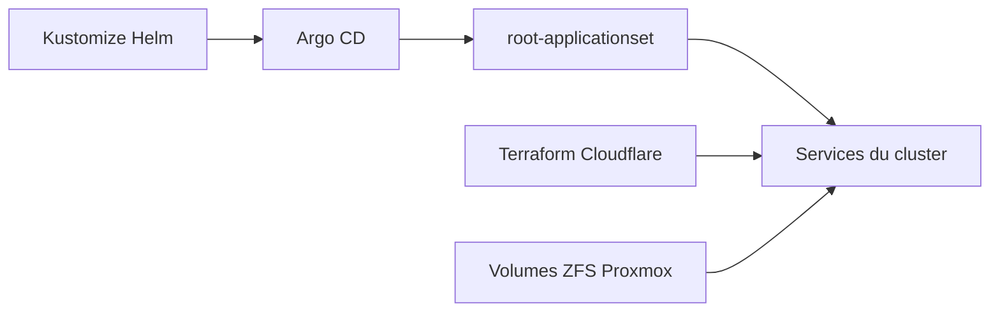

# zimmertr/Kubernetes-Manifests

> Manifestes Kubernetes personnels d'un homelab sous Proxmox, déployés avec Argo CD et Kustomize.

## Le problème
Un cluster perso demande de retrouver, à chaque reconstruction, les mêmes services, secrets et volumes.

## Ce que ça fait vraiment
Dépôt de services déployés avec Argo CD (schéma app-of-apps) sur un cluster TKS : Proxmox CCM, MetalLB et Istio ou Cilium, Cloudflare tunnel via Terraform. On y trouve aussi llama-swap, Open WebUI, LiteLLM, Jellyfin, Prometheus et Grafana. Secrets et volumes ZFS sont créés à la main.

## Comment c'est branché
Schéma simplifié d'après la fiche, sans diagramme fourni.



## Essayer
```bash
kustomize build --enable-helm argo/argo-cd | kubectl apply -f- --server-side --force-conflicts
kubectl apply -f root-appproject.yml
kubectl apply -f root-applicationset.yml
```

## Coût et pièges
Suppose un cluster TKS sur Proxmox, des volumes ZFS nommés en dur, Cloudflare et un abonnement Hevy Pro pour un service. Beaucoup de secrets à créer à la main.

## Ce que ce n'est pas
Pas un produit : c'est la configuration d'une seule personne, non prévue pour être réutilisée telle quelle. Pas de documentation des choix.

## Alternatives
Aucune alternative nommée dans le README.

## Pour toi
Surveiller : bon exemple à lire pour servir des LLM (llama-swap, LiteLLM, Open WebUI) sur Kubernetes, à adapter plutôt qu'à déployer.

