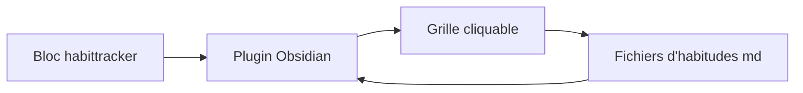

# zincplusplus/habit-tracker

> Obsidian plugin showing a 21-day habit tracking grid, for Obsidian users.

## The problem
Tracking habits in an Obsidian vault without leaving your notes means hacking together checkboxes.

## What it actually does
Displays a clickable grid from a `habittracker` block configured in JSON. Each habit is a Markdown file whose front matter stores the checked dates. Handles title, color, streaks and tolerance for missed days (`maxGap`), and opens the daily note when a date is clicked.

## How it is wired
Simplified diagram based on the sheet, no diagram provided.



## Trying it
```bash
git clone https://github.com/zincplusplus/habit-tracker
cd habit-tracker
npm install
npm run dev
```

## Cost and gotchas
Free. Normal installation is through Obsidian's community plugins. GPL-3.0 license: copyleft.

## What it is not
Not a standalone application: it requires Obsidian. No sync or advanced statistics mentioned.

## Alternatives
No alternative named in the README.

## For you
Ignore for your line of work: useful only if you track your habits in Obsidian, with no link to data or AI.
