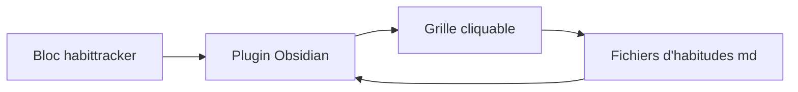

# zincplusplus/habit-tracker

> Plugin Obsidian affichant une grille de suivi d'habitudes sur 21 jours, pour les utilisateurs d'Obsidian.

## Le problème
Suivre des habitudes dans un coffre Obsidian sans quitter ses notes demande de bricoler des cases à cocher.

## Ce que ça fait vraiment
Affiche une grille cliquable à partir d'un bloc `habittracker` configuré en JSON. Chaque habitude est un fichier Markdown dont le front matter stocke les dates cochées. Gère titre, couleur, séries (streaks) et tolérance aux jours manqués (`maxGap`), et ouvre la note quotidienne au clic sur une date.

## Comment c'est branché
Schéma simplifié d'après la fiche, sans diagramme fourni.



## Essayer
```bash
git clone https://github.com/zincplusplus/habit-tracker
cd habit-tracker
npm install
npm run dev
```

## Coût et pièges
Gratuit. L'installation normale se fait depuis les extensions communautaires d'Obsidian. Licence GPL-3.0 : copyleft.

## Ce que ce n'est pas
Pas une application autonome : elle exige Obsidian. Pas de synchronisation ni de statistiques avancées citées.

## Alternatives
Aucune alternative nommée dans le README.

## Pour toi
À ignorer pour ton métier : utile seulement si tu suis tes habitudes dans Obsidian, sans lien avec la donnée ou l'IA.

