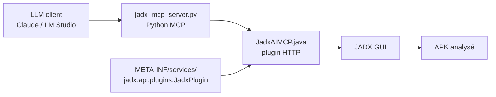

# zinja-coder/jadx-ai-mcp

> JADX plugin plus MCP server that let an LLM read and annotate a decompiled APK.

## The problem
Reading thousands of decompiled classes to understand or audit an Android application is slow; copying the code by hand into a chat is just as slow.

## What it actually does
A Java plugin in JADX-GUI opens a local HTTP API (port 8650); a Python FastMCP server translates it into MCP tools for Claude Desktop, Cherry Studio or LM Studio. The tools cover class sources, smali, manifest, resources, cross-references, renaming, comments and the state of the JADX debugger. The MCP server listens over stdio or HTTP (`--http`, port 8651).

## How it is wired


## Trying it
```bash
jadx plugins --install "github:zinja-coder:jadx-ai-mcp"
curl -LsSf https://astral.sh/uv/install.sh | sh
cd jadx-mcp-server
uv run jadx_mcp_server.py
uv run jadx_mcp_server.py --http --port 9999
```

## Cost and gotchas
Free; the LLM you use is at your expense. With `--host 0.0.0.0` the server is exposed over plain HTTP without authentication (README warning): stay on localhost or go through an SSH tunnel. The server is in a separate repository from the plugin.

## What it is not
Not an automatic scanner: it is a bridge that gives context to an LLM, whose answers still need to be verified. Tested mostly with Claude Desktop. Use is legitimate on applications for which you have the rights or the authorization to analyze (the README reminds this).

## Alternatives
`APKTool-MCP-Server` and `ZIN-MCP-Client`, from the same suite, cover other steps (disassembly, local client).

## For you
Watch: useful if you do authorized mobile auditing with an assistant, outside the data/MLOps core, and the project relies on a single maintainer.
