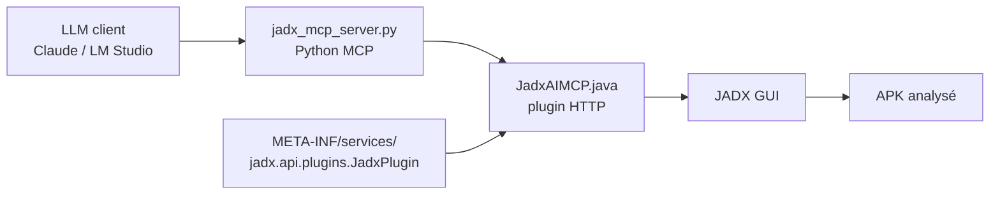

# zinja-coder/jadx-ai-mcp

> Plugin JADX plus serveur MCP qui laissent un LLM lire et annoter un APK décompilé.

## Le problème
Relire des milliers de classes décompilées pour comprendre ou auditer une application Android est long ; copier le code à la main dans un chat l'est autant.

## Ce que ça fait vraiment
Un plugin Java dans JADX-GUI ouvre une API HTTP locale (port 8650) ; un serveur Python FastMCP la traduit en outils MCP pour Claude Desktop, Cherry Studio ou LM Studio. Les outils couvrent sources de classes, smali, manifeste, ressources, références croisées, renommage, commentaires et état du débogueur JADX. Le serveur MCP écoute en stdio ou en HTTP (`--http`, port 8651).

## Comment c'est branché


## Essayer
```bash
jadx plugins --install "github:zinja-coder:jadx-ai-mcp"
curl -LsSf https://astral.sh/uv/install.sh | sh
cd jadx-mcp-server
uv run jadx_mcp_server.py
uv run jadx_mcp_server.py --http --port 9999
```

## Coût et pièges
Gratuit ; le LLM utilisé est à ta charge. Avec `--host 0.0.0.0` le serveur s'expose en HTTP clair sans authentification (avertissement du README) : rester en localhost ou passer par un tunnel SSH. Le serveur est dans un dépôt séparé du plugin.

## Ce que ce n'est pas
Pas un scanner automatique : c'est un pont qui donne du contexte à un LLM, dont les réponses restent à vérifier. Testé surtout avec Claude Desktop. L'usage est légitime sur des applications dont tu as les droits ou l'autorisation d'analyse (le README le rappelle).

## Alternatives
`APKTool-MCP-Server` et `ZIN-MCP-Client`, de la même suite, couvrent d'autres étapes (désassemblage, client local).

## Pour toi
À surveiller : utile si tu fais de l'audit mobile autorisé avec un assistant, hors du cœur data/MLOps, et le projet repose sur un seul mainteneur.

