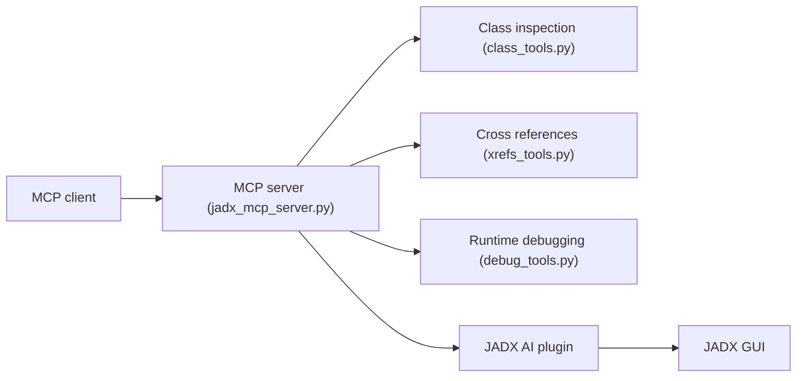

# zinja-coder/jadx-mcp-server

> Python MCP server that connects an LLM to the JADX decompiler to analyze Android APKs.

## The problem
Analyzing a decompiled Android application by hand is slow: classes, manifest, resources, cross-references.

## What it actually does
Receives MCP tool calls from an LLM client and forwards them over HTTP to a JADX-AI-MCP plugin in jadx-gui, which returns the context. Tools: reading classes and methods, smali, manifest, resources, variable renaming, paginated cross-references, debugging (stacks, threads, variables).

## How it is wired


## Trying it
```bash
uv run jadx_mcp_server.py --http
```

## Cost and gotchas
Free; you also need the jadx-ai-mcp plugin, installed separately. With --host 0.0.0.0, HTTP has no authentication or TLS: the whole network can call the tools.

## What it is not
Not an automatic vulnerability scanner: the LLM does the interpreting. Strictly legal use, on applications you have the right to analyze.

## Alternatives
No named alternative; the author's suite mentions APKTool-MCP-Server.

## For you
Ignore for data/AI work: a mobile reverse-engineering tool, useful only if that is your trade.
